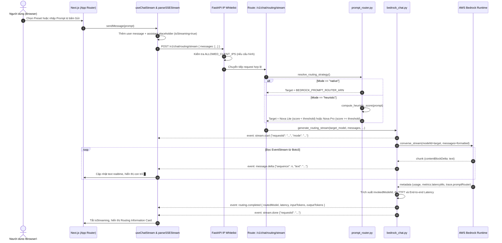

# TÀI LIỆU THIẾT KẾ KỸ THUẬT: INTELLIGENT PROMPT ROUTING & CONVERSESTREAM
## Module: Prompt Routing Chat (Màn hình 1)

- **Tệp đặc tả:** `.design/prompt_router_specs.md`
- **Phiên bản:** 1.0.0 (Dựa trên Source Code thực tế)
- **Trạng thái:** Implemented & Verified
- **Hệ thống:** AWS Bedrock GenAI Chat Studio PoC

---

## 1. TỔNG QUAN & MỤC TIÊU NGHIỆP VỤ

### 1.1. Mục tiêu
Module **Intelligent Prompt Routing** giải quyết bài toán cân bằng giữa **Chi phí (Cost)**, **Độ trễ (Latency)** và **Chất lượng câu trả lời (Response Quality)** trong các ứng dụng Generative AI:
- Với các câu hỏi đơn giản, ngắn, tra cứu định nghĩa cơ bản: Hệ thống tự động điều hướng sang mô hình nhỏ, tốc độ cao, siêu rẻ như **Amazon Nova Lite** (`amazon.nova-lite-v1:0`).
- Với các câu hỏi lập luận logic đa bước, thiết kế kiến trúc phân tán, viết mã nguồn phức tạp: Hệ thống điều hướng sang mô hình năng lực cao như **Amazon Nova Pro** (`amazon.nova-pro-v1:0`).

### 1.2. Năng lực kỹ thuật cốt lõi
1. **Truyền phản hồi dạng dòng (Real-time Streaming):** Sử dụng API `ConverseStream` của Amazon Bedrock và giao thức Server-Sent Events (SSE) qua HTTP POST để tạo hiệu ứng gõ chữ (typewriter) tức thì kèm con trỏ nhấp nháy `█`.
2. **Cơ chế định tuyến kép (Dual-Mode Routing):**
   - **Native Mode (AWS Bedrock Prompt Router):** Gọi trực tiếp qua Prompt Router ARN trên AWS. Model thực tế được chọn được đọc chính xác từ `metadata.trace.promptRouter.invokedModelId`.
   - **Smart Heuristic Fallback (Local Rule-based):** Tự động chấm điểm độ phức tạp đa chiều (độ dài, cấu trúc, từ khóa kỹ thuật EN/VN, yêu cầu viết code) để quyết định chọn Nova Lite hay Nova Pro khi chưa có Prompt Router ARN trên AWS.
3. **Đo lường & Hiển thị chỉ số (Telemetry Information):** Ngay khi hoàn tất stream, hiển thị minh bạch: Mô hình được chọn, Độ trễ tổng (`Latency`), Thời gian tới token đầu tiên (`TTFT`), Số `Input Tokens` và `Output Tokens`.

---

## 2. KIẾN TRÚC TỔNG THỂ & LUỒNG DỮ LIỆU (SEQUENCE DIAGRAM)



---

## 3. LOGIC XỬ LÝ CHI TIẾT THEO TỪNG FILE MÃ NGUỒN

### 3.1. Phía Back-End (Python / FastAPI)

#### A. Cấu hình & Bảo mật: `app/core/config.py` & `app/main.py`
- **`ROUTING_MODE`:** Nhận các giá trị `auto`, `native`, `heuristic`.
  - Trong chế độ `auto`: Nếu biến `BEDROCK_PROMPT_ROUTER_ARN` có giá trị, tự động kích hoạt `native`; nếu rỗng, tự động chuyển sang `heuristic`.
- **`ALLOWED_CLIENT_IPS`:** Giới hạn chỉ IP được phép (ví dụ `210.245.54.242`) mới có thể truy cập API. Middleware `ip_whitelist_middleware` chặn các IP khác với mã `403 Forbidden`.

#### B. Bộ điều hướng thông minh: `app/services/prompt_router.py`
Chịu trách nhiệm phân loại độ phức tạp câu hỏi khi chạy ở chế độ Heuristic:
- **Hàm `compute_heuristic_score(prompt: str) -> (score, reasons)`:**
  1. **Độ dài câu hỏi:**
     - `> 600 ký tự`: +3 điểm.
     - `> 300 ký tự`: +2 điểm.
     - `> 120 ký tự`: +1 điểm.
  2. **Từ khóa chuyên sâu (hỗ trợ cả tiếng Anh và tiếng Việt):**
     - Quét danh sách regex: `architect`, `kiến trúc`, `thiết kế`, `distributed`, `phân tán`, `microservice`, `event-driven`, `resilient`, `chịu tải`, `high availability`, `disaster recovery`, `code`, `script`, `viết code`, `lập trình`, `implementation`, `algorithm`, `thuật toán`, `concurrency`, `asyncio`, `compare`, `so sánh`, `trade-off`, `analyze`, `phân tích`, `tối ưu`, `security`, `bảo mật`...
     - Mỗi từ khóa phát hiện cộng 1 điểm (tối đa +4 điểm).
  3. **Độ phức tạp cấu trúc:**
     - Có danh sách từ 3 bước trở lên (`1.`, `2.`, `3.`): +2 điểm.
     - Có nhiều dòng hoặc 2 bước: +1 điểm.
  4. **Yêu cầu viết code thực thi:**
     - Chứa các cụm như `write code`, `viết code`, `python module`, `implement`: +1 điểm.
- **Quyết định điều hướng (`determine_heuristic_target`):**
  - So sánh `score` với `settings.router_heuristic_threshold` (mặc định = 3):
    - `score >= 3`: Điều hướng sang **`amazon.nova-pro-v1:0`** (kèm lý do kỹ thuật chi tiết).
    - `score < 3`: Điều hướng sang **`amazon.nova-lite-v1:0`** (tối ưu chi phí và độ trễ).

#### C. Sinh dòng dữ liệu ConverseStream: `app/services/bedrock_chat.py`
- **Định dạng dữ liệu chuẩn Converse API:**
  Chuyển đổi danh sách tin nhắn sang cấu trúc hợp lệ của Boto3:
  ```python
  {"role": "user" | "assistant", "content": [{"text": "Nội dung"}]}
  ```
- **Xử lý bất đồng bộ an toàn (Thread pool execution):**
  Boto3 `converse_stream` là thư viện đồng bộ (synchronous). Hàm `generate_routing_stream` được triển khai dưới dạng synchronous generator để Starlette tự động chạy trên worker thread pool, **không gây nghẽn (block) asyncio event loop** của FastAPI.
- **Bóc tách Metadata & Trace:**
  - `ttft_ms`: Đo bằng `time.perf_counter()` khi token đầu tiên xuất hiện.
  - `modelLatencyMs`: Đọc từ `metadata.metrics.latencyMs` do AWS Bedrock đo.
  - `routedModelId`: Đọc từ `metadata.trace.promptRouter.invokedModelId`. Nếu chạy Native Router trên AWS, trường này cho biết chính xác 100% mô hình AWS đã lựa chọn.

---

### 3.2. Phía Front-End (Next.js 15 / TypeScript / Tailwind CSS)

#### A. Trình phân tích SSE Stream: `src/lib/sse-parser.ts`
- Sử dụng `TextDecoder("utf-8", { stream: true })`.
- Xử lý mượt mà hiện tượng phân mảnh gói tin TCP (chunk buffering) và chuẩn hóa ngắt dòng `\r\n` -> `\n`.
- Nhận diện đúng từng loại event (`stream.start`, `message.delta`, `routing.completed`, `error`, `stream.done`).

#### B. Quản lý trạng thái hội thoại: `src/hooks/use-chat-stream.ts`
- Quản lý State Machine: `idle` ➔ `connecting` ➔ `streaming` ➔ `completed` / `error` / `cancelled`.
- Hỗ trợ nút **Stop Generation** thông qua `AbortController` (hủy stream ngay lập tức khi người dùng bấm Stop).

#### C. Giao diện trực quan: `src/components/routing-telemetry.tsx`
Khối hiển thị thông số kỹ thuật được đặt ngay bên dưới tin nhắn trả lời của AI:
- **`Routed Model`:** Tên model kèm huy hiệu (Badge) nhận diện chế độ (*Native Bedrock Prompt Router* hoặc *Local Heuristic Fallback*).
- **`Latency`:** Tổng thời gian thực thi (ví dụ: `1.2 sec`) kèm chỉ số TTFT (ví dụ: `240ms`).
- **`Input Tokens` & `Output Tokens`:** Số lượng token tiêu thụ theo báo cáo từ Bedrock.
- **`Routing Reason`:** Giải thích lý do vì sao câu hỏi được điều hướng vào model đó.

---

## 4. CHI TIẾT API CONTRACT & SSE WIRE PROTOCOL

### 4.1. Endpoint Request
- **URL:** `POST /v1/chat/routing/stream`
- **Headers:**
  ```http
  Content-Type: application/json
  Accept: text/event-stream
  ```
- **Request Body:**
  ```json
  {
    "messages": [
      {
        "role": "user",
        "content": "What is Amazon S3?"
      }
    ]
  }
  ```

### 4.2. Response SSE Events Protocol

#### 1. Sự kiện `stream.start`
Phát ra ngay khi kết nối được thiết lập trước khi gọi AWS:
```text
event: stream.start
data: {"requestId":"req_3f9a1b2c4d5e","mode":"native","createdAt":"2026-09-27T08:00:00Z"}
```

#### 2. Sự kiện `message.delta`
Phát ra liên tục mỗi khi có token mới đổ về:
```text
event: message.delta
data: {"sequence":1,"text":"Amazon "}

event: message.delta
data: {"sequence":2,"text":"S3 is an object storage "}
```

#### 3. Sự kiện `routing.completed`
Phát ra khi stream văn bản kết thúc, chứa toàn bộ telemetry:
```text
event: routing.completed
data: {
  "routingMode": "native",
  "routedModelId": "arn:aws:bedrock:us-east-1::foundation-model/amazon.nova-lite-v1:0",
  "routedModelName": "Amazon Nova Lite",
  "inputTokens": 18,
  "outputTokens": 95,
  "modelLatencyMs": 960.0,
  "ttftMs": 240.0,
  "endToEndLatencyMs": 1200.0,
  "routingReason": "AWS Bedrock Intelligent Prompt Router selected model"
}
```

#### 4. Sự kiện `stream.done`
Báo hiệu kết thúc hoàn toàn request:
```text
event: stream.done
data: {"requestId":"req_3f9a1b2c4d5e"}
```

#### 5. Sự kiện `error` (Nếu xảy ra sự cố)
```text
event: error
data: {
  "code": "BEDROCK_ACCESS_DENIED",
  "message": "Access denied to AWS Bedrock. Please verify AWS credentials and model access.",
  "retryable": false,
  "requestId": "req_3f9a1b2c4d5e"
}
```

---

## 5. BỘ DỮ LIỆU KIỂM THỬ ĐIỀU HƯỚNG (BENCHMARK PROMPTS)

Để kiểm chứng tính năng Intelligent Routing hoạt động chính xác, ứng dụng cung cấp sẵn các nút bấm (Preset Chips) phân định rõ ràng:

### Nhóm 1: Câu hỏi kiểm chứng điều hướng vào Amazon Nova Lite (Simple)
1. `"What is Amazon S3 and what are its primary storage classes?"`
   - *Đặc điểm:* Câu hỏi tra cứu định nghĩa cơ bản, không có ràng buộc đa bước.
   - *Kết quả dự kiến:* Routed Model = **Amazon Nova Lite** (Độ trễ thấp < 1.5s).
2. `"How does Amazon S3 bucket versioning work in two concise sentences?"`
   - *Đặc điểm:* Yêu cầu tóm tắt ngắn, độ dài dưới 100 ký tự.
   - *Kết quả dự kiến:* Routed Model = **Amazon Nova Lite**.

### Nhóm 2: Câu hỏi kiểm chứng điều hướng vào Amazon Nova Pro (Complex)
1. **`🚀 100k TPS IoT Arch (PRO)`**:
   > *"Act as a Principal AWS Solutions Architect. Provide an exhaustive, production-grade architectural design for an event-driven telemetry ingestion system on AWS handling 100,000 TPS. Requirements: 1. Kinesis Data Streams hashing... 2. Lambda parallelization... 3. DynamoDB Global Tables vs Timestream... 4. Multi-region Active-Active DR RTO<1min RPO=0... 5. ASCII diagram."*
   - *Đặc điểm:* Đòi hỏi tư duy kiến trúc bậc cao, nhiều ràng buộc định lượng, phân tích so sánh và vẽ sơ đồ.
   - *Kết quả dự kiến:* Routed Model = **Amazon Nova Pro**.
2. **`🚀 Distributed Saga Code (PRO)`**:
   > *"Write a production-grade, highly concurrent Python module using asyncio, aioboto3, and botocore implementing the Saga Orchestration Pattern for distributed e-commerce transactions across Payment, Inventory, and Order microservices with idempotency and circuit breaker."*
   - *Đặc điểm:* Yêu cầu sinh mã nguồn phức tạp, xử lý đồng thời, bồi hoàn giao dịch và kiểm thử unit test.
   - *Kết quả dự kiến:* Routed Model = **Amazon Nova Pro**.
3. **`🚀 Kiến trúc Ngân hàng số (PRO - VN)`**:
   > *"Đóng vai trò là Kiến trúc sư trưởng giải pháp AWS. Hãy thiết kế kiến trúc hệ thống xử lý thanh toán tài chính phân tán cho ngân hàng số đạt chuẩn PCI-DSS với thông lượng 50.000 TPS..."*
   - *Đặc điểm:* Câu hỏi tiếng Việt chuyên sâu với 4 yêu cầu kiến trúc ngân hàng số khắt khe.
   - *Kết quả dự kiến:* Routed Model = **Amazon Nova Pro**.

---

## 6. CẤU HÌNH BIẾN MÔI TRƯỜNG (`.env`)

```dotenv
# Cấu hình Routing Mode: 'auto' | 'native' | 'heuristic'
ROUTING_MODE=auto

# ARN của Bedrock Prompt Router (Tạo trên AWS Bedrock Console)
BEDROCK_PROMPT_ROUTER_ARN=arn:aws:bedrock:us-east-1:123456789012:prompt-router/nova-router-demo

# Model IDs dự phòng
BEDROCK_FAST_MODEL_ID=amazon.nova-lite-v1:0
BEDROCK_SMART_MODEL_ID=amazon.nova-pro-v1:0
ROUTER_HEURISTIC_THRESHOLD=3

# Bảo mật IP Client
ALLOWED_CLIENT_IPS=210.245.54.242
```
